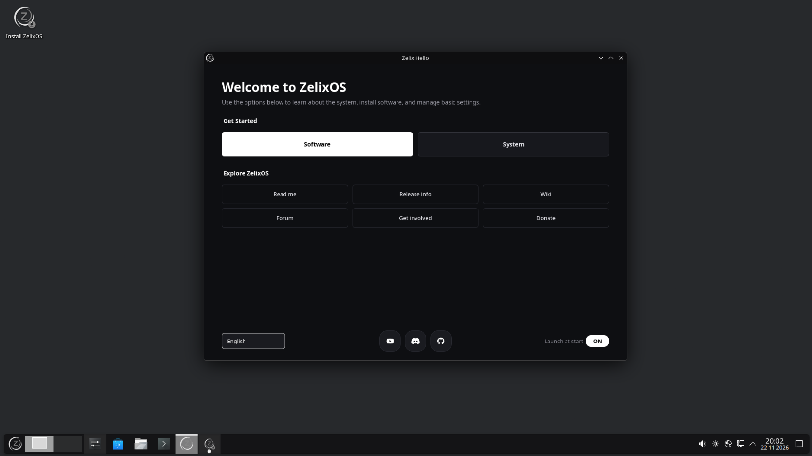

# Zelix Hello

Zelix Hello is the welcome and system-management application for ZelixOS. It is written in Python and PyQt6 and provides a starting point for learning about the system, installing software, checking hardware, and adjusting common services.



The interface is available in English, Turkish, and Spanish. Its language choice is saved for later sessions; on first launch it follows `LC_ALL`, `LC_MESSAGES`, and then `LANG`.

## What you can do

| Area | What it provides |
| --- | --- |
| Welcome | Project links, the included getting-started notes, and release information. |
| Applications | Search and select applications from enabled Arch repositories, Flatpak, and the AUR. Install a gaming setup with Steam, Lutris, Heroic, Wine, and supporting tools from one button. |
| System | Run system updates, open Zelix Updater, optimize mirrors, enable Flathub, clear package cache, and remove orphaned packages. Command output is shown in the application. |
| Drivers | Inspect detected hardware, view suggested driver packages, and install selected packages. Suggestions are based on detected hardware and installed system information. |
| Tweaks | Check and manage Bluetooth, UFW firewall, periodic SSD trim, and printing services. |

Software sources have different requirements: packages from enabled Arch repositories (including ZelixRepo) use pacman, Flatpak packages need Flatpak/Flathub, and AUR packages need a supported AUR helper. Zelix Hello does not make AUR packages part of the normal pacman system update.

The gaming setup enables multilib when needed, updates system packages, then installs game launchers, compatibility tools, audio and video runtimes, and 32-bit libraries. It selects AMD and Intel Vulkan libraries from detected graphics hardware and adds NVIDIA's 32-bit userspace library when the matching driver is already installed. It saves a backup of `/etc/pacman.conf` before changing multilib settings. Kernel graphics drivers remain hardware specific and are managed in the Drivers page. Application installs open in the terminal preferred by the desktop or the `TERMINAL` environment variable.

## Install on ZelixOS

With the `zelixrepo` repository enabled, refresh package databases and install the application:

```bash
sudo pacman -Syu zelix-hello
```

Launch it from the applications menu or run:

```bash
zelix-hello
```

The package also starts the welcome application automatically when the user logs in. You can change the launch-at-start setting in the welcome screen.

## First-use guide

1. Open **Applications** and search or browse by category.
2. Select packages and check their source before installing. Enable multilib when required for 32-bit applications such as Steam.
3. Use **Drivers** to refresh hardware detection, review suggestions, select what you need, and start the package installation.
4. In **System**, choose the update, mirror, cache, orphan cleanup, or Flathub action. Review the command output before closing the page.
5. In **Tweaks**, refresh service status before changing Bluetooth, firewall, trim, or printing. A service change affects the system, not only this application.
6. Open the language selector to switch English, Türkçe, or Español. The choice is remembered for this user.

### Updating and maintenance

The system update action uses pacman for the configured system repositories. AUR and Flatpak applications use their own update tools. Mirror optimization can replace the pacman mirror list. Cache and orphan cleanup remove locally stored package data or unused packages; review the displayed command output and package selection when offered.

## Run from source

On an Arch-based development system, install Python, PyQt6, Qt SVG support, and Polkit, then run:

```bash
git clone https://github.com/ZelixOS/zelix-hello.git
cd zelix-hello
python main.py
```

The graphical session should have a Polkit authentication agent for operations that need administrator privileges. Optional integrations need their respective tools: pacman, Flatpak, an AUR helper, `rate-mirrors`, and hardware utilities.

## Troubleshooting

- **A software source is unavailable:** confirm the corresponding repository or tool is configured (Arch, ZelixRepo, Flatpak/Flathub, or an AUR helper).
- **An administrator prompt does not appear:** make sure a Polkit authentication agent is running in the desktop session.
- **A driver suggestion looks unexpected:** refresh the hardware scan and review the package details before installing. Hardware detection is advisory.
- **A service toggle fails:** check that the corresponding package and systemd unit are installed, then inspect the output shown in the System/Tweaks page.
- **The interface language did not change:** use the in-app language selector; system locale environment variables are used only as the initial choice.

## Source layout

| Path | Purpose |
| --- | --- |
| `main.py` | Application entry point |
| `tabs/` | Welcome, applications, system, drivers, and tweaks pages |
| `ui/` | Main window and shared styles |
| `utils/` | Commands, translations, and language preference |
| `assets/` | Application icons and graphics |

The package recipe is maintained in [ZelixRepo](https://github.com/ZelixOS/zelix-repo/tree/main/zelix-hello).

## Contributing and support

Report the Zelix Hello version, ZelixOS version, affected page, steps to reproduce, and relevant output. Remove personal information from logs. Contributions to translations should update English, Turkish, and Spanish strings together.
